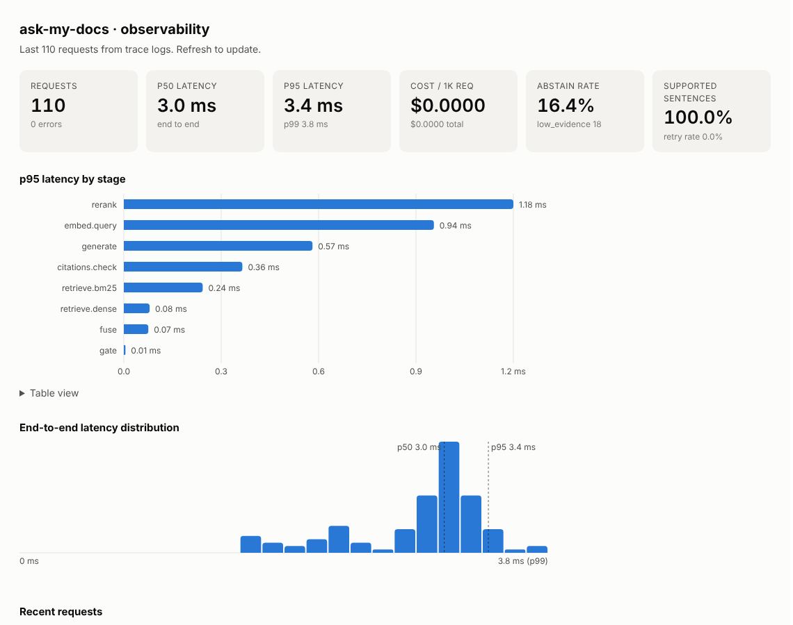
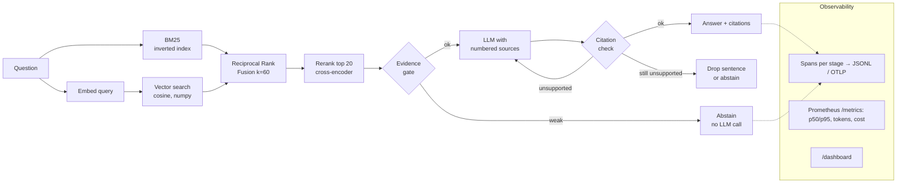

# Ask My Docs: production-style RAG with an eval gate

**Ask questions about a document set and get answers where every sentence cites its source, or no answer at all. Retrieval is hybrid (BM25 + vectors) with reranking, every request is traced, and CI blocks merges that make answers worse.**

[](https://github.com/AryanB710/ask-my-docs/actions/workflows/ci.yml)


<!-- Replace with a 10–15s GIF of the chat UI: ask a question, click a citation, ask an out-of-scope question and show the refusal. -->


## Architecture



## Results

### CI profile (deterministic, runs on every PR)

<!-- RESULTS:CI:START -->
| Variant | Recall@5 | MRR@10 | nDCG@10 | Answer acc. | Citation prec. | Supported sent. | Abstain (OOS) | False abstain | p50 ms | p95 ms | $ / 1k q |
|---|---:|---:|---:|---:|---:|---:|---:|---:|---:|---:|---:|
| bm25 | 1.000 | 0.933 | 0.950 | 79.2% | 84.4% | 100.0% | 85.7% | 6.2% | 0.9 | 1.2 | 0.0000 |
| dense | 0.979 | 0.930 | 0.947 | 79.2% | 83.3% | 100.0% | 85.7% | 6.2% | 1.4 | 10.5 | 0.0000 |
| hybrid (RRF) | 0.979 | 0.930 | 0.947 | 79.2% | 83.3% | 100.0% | 85.7% | 6.2% | 1.5 | 1.7 | 0.0000 |
| **hybrid+rerank** (gated) | 1.000 | 0.939 | 0.955 | 79.2% | 84.4% | 100.0% | 85.7% | 6.2% | 2.2 | 2.5 | 0.0000 |
| hybrid+rerank, no headers | 1.000 | 0.944 | 0.959 | 75.0% | 83.3% | 100.0% | 85.7% | 6.2% | 2.2 | 2.4 | 0.0000 |
| hybrid+rerank, 250-word chunks | 1.000 | 0.939 | 0.955 | 79.2% | 86.7% | 100.0% | 85.7% | 6.2% | 2.2 | 2.5 | 0.0000 |

<sub>55 questions (7 out of scope), 48 chunks from 9 docs · profile `configs/offline.yaml` · embedding `lsa-256` · generator `extractive` · commit `local` · 2026-11-24 19:36 UTC<br>p50 per stage (ms), primary variant: rerank 0.96, embed.query 0.45, generate 0.39, citations.check 0.16, retrieve.bm25 0.08, fuse 0.03, retrieve.dense 0.02, gate 0.00</sub>
<!-- RESULTS:CI:END -->

How to read it:

- **Retrieval columns** (Recall@5, MRR@10, nDCG@10) count a chunk as relevant if it comes from the right document and contains the gold evidence text. This stays valid when chunking changes, which chunk-ID labels would not.
- **Answer acc.** is the share of answerable questions where the answer contains every required fact.
- **Citation prec.** is the share of cited chunks that contain gold evidence.
- **Supported sent.** is the share of answer sentences that pass the citation check.
- **Abstain (OOS)** is the share of out-of-scope questions that were refused. You want it high.
- **False abstain** is the share of answerable questions that were refused. You want it low.

This profile uses **no ML models**: LSA vectors stand in for a neural embedder, a lexical scorer for the cross-encoder, and an extractive sentence picker for the LLM. That makes it fast, free and exactly reproducible, which is what a merge gate needs. Answer accuracy here is a floor, not a showcase. Latency is in milliseconds because there's no model in the loop.

### Local profile (Ollama + cross-encoder)

<!-- RESULTS:LOCAL:START -->
_Not generated yet. Run `make eval-local` with Ollama running to fill this table._
<!-- RESULTS:LOCAL:END -->

### Three local LLMs on the same retrieval

<!-- RESULTS:MODELS:START -->
_Not generated yet. Run `make eval-models`. Compares llama3.2:3b, qwen2.5:3b and phi3.5 on quality, latency and citation compliance._
<!-- RESULTS:MODELS:END -->

## Quickstart

```bash
git clone https://github.com/AryanB710/ask-my-docs && cd ask-my-docs
pip install -e ".[api,dev]"

askdocs ask "What is the publish rate limit on the legacy API?"
askdocs ask "Is LumenQueue SOC 2 certified?"        # out of scope, so it abstains
make eval && make gate                              # golden set + regression gate
askdocs serve                                       # http://127.0.0.1:8000 (UI), /dashboard, /metrics, /docs
```

With real models, fully local and private:

```bash
pip install -e ".[api,ml]"
ollama pull llama3.2:3b && ollama pull nomic-embed-text
askdocs serve --config configs/local.yaml
```

Any OpenAI-compatible API (OpenAI, Groq, Together, vLLM) works through `configs/cloud.yaml`.

## What's in here

| Area | What it does | Where |
|---|---|---|
| Ingestion | Markdown, HTML and PDF. Heading-aware chunking that never crosses a section and keeps table rows whole. Index is cached and keyed on corpus hash + config | `askdocs/ingest/` |
| Hybrid retrieval | BM25 written from scratch, dense search with pluggable embedders (sentence-transformers, Ollama, OpenAI, LSA), fused with RRF | `askdocs/retrieval/` |
| Reranking | Cross-encoder (`ms-marco-MiniLM-L-6-v2`) or a lexical fallback, both scored 0–1 so one gate threshold works for either | `retrieval/rerank.py` |
| Citation enforcement | Every sentence must cite a valid source. Its content words must appear in the cited chunk, and every number or identifier must match exactly. On failure: regenerate once with feedback, then drop the sentence or abstain | `generation/citations.py` |
| Abstention | An evidence gate before the LLM (saves cost on out-of-scope questions) plus model-side refusal. Threshold chosen with `askdocs calibrate` | `pipeline.py` |
| Tracing | Nested spans per stage, written to JSONL. Optional OpenTelemetry export to Jaeger/Tempo | `obs/tracing.py` |
| Metrics | Prometheus `/metrics`: latency histograms per stage, tokens, cost, abstentions, citation failures, user feedback | `obs/metrics.py` |
| Cost | Tokens × a pricing table in YAML, per request | `obs/cost.py`, `configs/pricing.yaml` |
| Dashboard | Self-contained HTML: p50/p95/p99, per-stage latency, cost per 1k requests, abstain rate, supported-sentence rate | `obs/dashboard.py` |
| Eval | 55-question golden set (7 out of scope, 5 deliberately paraphrased), ablation suites, optional LLM judge | `eval/`, `askdocs/eval/` |
| CI gate | Absolute floors plus regression checks vs a committed baseline, a sticky PR comment, and a nightly neural-model eval | `.github/workflows/` |

## Observability

Every request produces a trace. This one is for "What does error LQ-1033 mean?" on the CI profile:

```
ask                      3.20 ms
├─ retrieve              2.40 ms  evidence_score=0.67
│  ├─ retrieve.bm25      0.20 ms  hits=7
│  ├─ embed.query        1.27 ms  model=lsa-256
│  ├─ retrieve.dense     0.06 ms  hits=30
│  ├─ fuse               0.04 ms  method=rrf candidates=30
│  └─ rerank             0.73 ms  model=lite pool=20
├─ gate                  0.01 ms  threshold=0.30 passed=true
├─ generate              0.40 ms  prompt_tokens=638 completion_tokens=36
└─ citations.check       0.30 ms  coverage=1.0 support_ratio=1.0
```

With a real LLM, `generate` takes hundreds of milliseconds to seconds while everything else stays in the low milliseconds. That is why the gate skips the LLM whenever evidence is weak.

- `askdocs report --html runs/dashboard.html` builds the dashboard from trace logs. The API serves the same page live at `/dashboard`.
- `docker compose up` starts the API plus Prometheus. `deploy/alerts.example.yml` has alert rules for p95 latency, abstain-rate spikes and citation-failure rate.
- Set `observability.otel: true` and `pip install .[otel]` to send the same spans to any OTLP collector.
- `POST /feedback` records thumbs up/down against a `trace_id`, so bad answers can be traced back to what was retrieved.

## The CI eval gate

On every PR, `eval-gate` runs the golden set and `askdocs gate` compares the result to `eval/thresholds.yaml` (absolute floors) and `eval/baseline.json` (last accepted run). It fails the build when:

- any metric falls below its floor, or
- any quality metric drops by more than 0.025 vs baseline. With 48 answerable questions, one question flipping is allowed and two are not.

Here's the gate catching a real regression. I set the evidence threshold to 0 (gate disabled):

```
### ❌ Eval gate failed (2 checks)
| Metric                    | Check      | Baseline | Current | Δ      | Limit    |   |
| unanswerable_abstain_rate | floor      | –        | 0.429   |        | >= 0.7   | ❌ |
| unanswerable_abstain_rate | regression | 0.857    | 0.429   | -0.429 | >= 0.832 | ❌ |
| answer_accuracy           | floor      | –        | 0.833   |        | >= 0.7   | ✅ |
```

Answer accuracy went *up* (79.2% → 83.3%), so a dashboard that only tracked accuracy would have shipped this change. It also started answering 4 of the 7 out-of-scope questions with whatever text it found closest.

To accept a deliberate change (new corpus, new model), run `make baseline` and commit `eval/baseline.json` in the same PR, so the baseline change gets reviewed like code.

## Design decisions

- **RRF instead of a weighted score sum.** BM25 scores are unbounded and cosine similarity sits in [-1, 1]. Mixing them needs normalisation that breaks when the corpus changes. RRF uses only ranks and has one parameter.
- **Relevance labelled by evidence text, not chunk IDs.** Changing chunk size changes every chunk ID. Labelling by "doc + contains this text" keeps chunking ablations comparable.
- **An evidence gate before the LLM, not only a refusal instruction in the prompt.** It's cheaper (no LLM call for out-of-scope questions) and doesn't depend on a small model following instructions.
- **Lexical citation check plus a hard number rule, with an optional LLM judge for meaning.** The lexical check is deterministic and explainable, so it can run in the request path and in CI. The judge is noisy and costs money, so it runs nightly.
- **A deterministic CI profile.** A gate that flakes gets ignored. Neural models and LLM grading run in the nightly job.
- **Brute-force numpy vector search.** It's exact, has no build step, and is fast below about 100k chunks. FAISS or a vector DB is a one-class swap when the corpus grows.
- **Prices in YAML, not code.** They change. Unknown models log a warning and count as $0 instead of crashing.

## What I tried that didn't work

All numbers are from the CI profile on this corpus.

1. **An overlap-only citation check let a fabricated number through.** "The legacy API allows 9,999 publish requests per second [1]" scored 0.75 support against a source that says 500, because every other word matched. I added a hard rule: every number and identifier in a sentence must appear in a cited chunk. There's a regression test for this exact case (`tests/test_citations_and_pipeline.py`).
2. **Adding a retriever doesn't automatically help.** BM25 alone reached Recall@5 = 1.000 here. Fusing it with the weak LSA retriever *lowered* recall to 0.979, because RRF pulled LSA's false positives into the top 5. The reranker recovered it. Lesson: measure each retriever on its own before fusing, and don't skip the reranker.
3. **My first evidence threshold (0.35, picked by intuition) refused 16.7% of answerable questions.** `askdocs calibrate` swept the threshold. 0.30 refuses 85.7% of out-of-scope questions with a 6.2% false-abstain rate. Caveat: I calibrated on the same 55 questions I report, which makes the numbers optimistic. A real deployment needs a separate dev split.
4. **Larger chunks (250 words) barely changed anything.** The index went from 48 chunks to 47 and the retrieval metrics were identical. Sections in these docs are short, and the chunker never crosses a heading, so most chunks are already whole sections. Chunk size matters much more for long, unstructured documents.
5. **Lexical matching fails on vocabulary mismatch.** 3 of the 5 deliberately paraphrased questions are refused: "wire transfer" vs "bank transfer", "refused" vs "rejected", "cut my bill" vs "reduces cost". This is what the neural embedder and cross-encoder in the local profile are for. Compare the two tables above.
6. **Contextual headers (prefixing each chunk with "Doc > Section") were inconclusive.** Answer accuracy was 79.2% with headers and 75.0% without, but that's 2 questions out of 48, and MRR was slightly higher without them. Too small a sample to claim a win.

## Bring your own docs

```bash
askdocs ingest path/to/your/docs --config configs/local.yaml   # .md .txt .html .pdf
askdocs ask "..." --config configs/local.yaml --set corpus_dir=path/to/your/docs
```

Then write a golden set in `eval/golden.jsonl`, one JSON object per line:

```json
{"id": "q01", "question": "...", "answerable": true,
 "evidence": [{"doc": "file.md", "contains": "exact text from the doc"}],
 "answer": "reference answer", "must_include": ["key fact"]}
```

Include out-of-scope questions (`"answerable": false`) and paraphrased ones, or the eval will flatter you. `scripts/make_golden.py` shows how the demo set is built and checks that every evidence string actually exists in the docs.

## Project layout

```
askdocs/
  ingest/       loaders (md/html/pdf), heading-aware chunker, cached index
  retrieval/    bm25.py, dense.py, fusion.py (RRF), rerank.py, retriever.py
  generation/   prompts.py, llm.py (OpenAI-compatible + extractive), citations.py
  obs/          tracing.py, metrics.py (Prometheus), cost.py, dashboard.py
  eval/         metrics.py, runner.py (ablations, calibration), gate.py, judge.py
  api/          FastAPI server + single-file chat UI
  pipeline.py   the request path, start to finish
configs/        offline (CI) · local (Ollama) · cloud (any OpenAI-compatible API) · pricing
eval/           golden.jsonl · suites/ · thresholds.yaml · baseline.json
data/demo/      fictional "LumenQueue" docs used for reproducible evals (see its README)
deploy/         Prometheus scrape config + example alert rules
```

## Limitations and next steps

- The demo corpus is small (9 docs, 48 chunks) and fictional by design. Numbers on a real corpus will differ.
- The golden set has 55 questions, so differences under about 4 points are within noise.
- No streaming responses or caching yet. A semantic cache in front of retrieval is the obvious next cost win.
- No multi-turn conversation. Each question is answered on its own.
